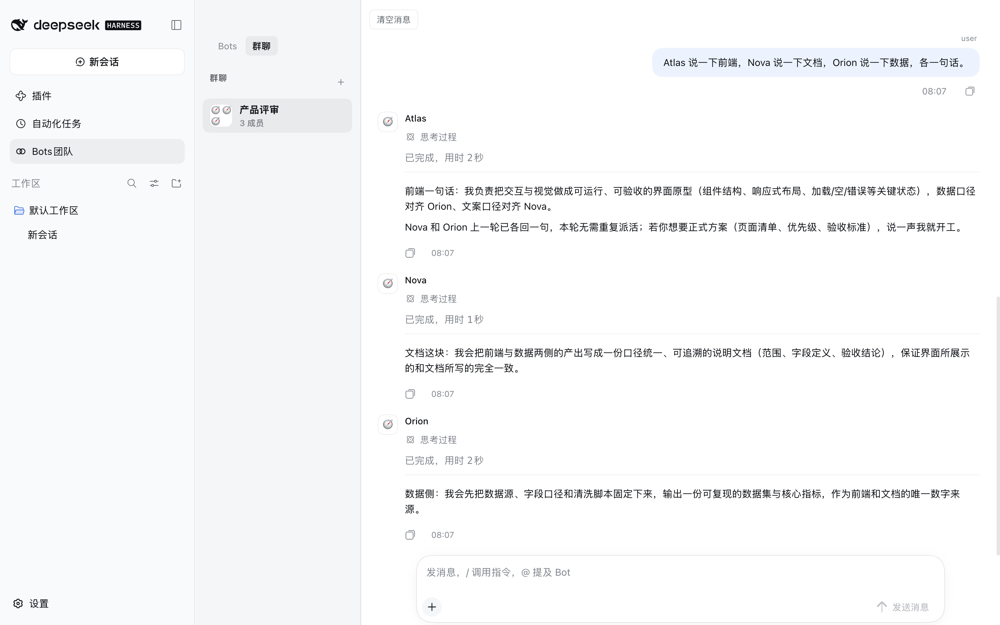
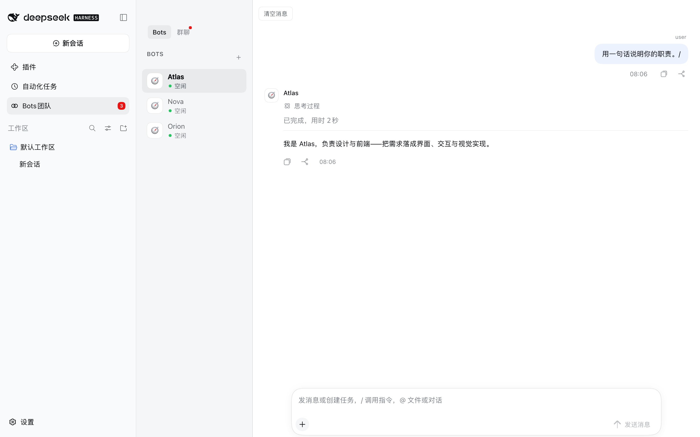
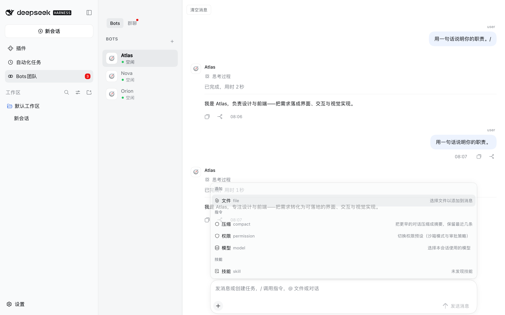

<div align="center">

# Agent Community — Bots for DeepSeek Harness

**Persistent Bots, group rooms and a durable run ledger, inside DSH.**

[简体中文](README.zh-CN.md) · [Design notes](DESIGN.md) · [MIT](LICENSE)

[](LICENSE)
[](#requirements)
[](https://github.com/topics/dsh-plugin)

</div>

> A community-maintained DeepSeek Harness plugin, not an official DeepSeek product.

A Bot here is not a temporary subagent: it has an identity, its own model and permission preset, its own
workspace, and its own session that survives a restart. That session is a native DSH Session, kept out of
DSH's sidebar — the panel shows rooms, never sessions. Put several Bots in a room and the room behaves
like a small team: the leader (or your explicit @mention) decides who answers, unaddressed messages can be
triaged, work is dispatched and tracked, and shared experience accumulates across tasks. Every run is
recorded, so a conversation can be read back later even after the session that produced it is gone.

**Current release: [0.4.1](CHANGELOG.md)** — leader triage for unaddressed group messages, automatic
group-experience condensing, group rules (`[本群规则]`), safer rehearsals, and a compaction-safe empty-reply
fix.

<p align="center"></p>

## Features

- **Bots that persist.** Each Bot keeps a name, a model, a permission preset and a workspace on disk. It
  is listed in the panel and answers in any room it belongs to, before and after a restart.
- **One-to-one and group conversations.** A room is a list of members. A message addressed to one Bot
  routes to that Bot. An unaddressed group message follows the room setting: by default the existing
  routing rules decide (leader fallback for greetings), or you can switch the room to **由群主判断** and
  the leader decides whether to answer, dispatch to a member, or stay quiet.
- **Runs are queued, leased and recoverable.** Each answer is a run with a lease and a heartbeat. A run
  whose runtime dies is reclaimed instead of blocking the room, and a room keeps working while you do
  something else. **The user's own message goes first**: when the live-session ceiling is full, a run
  you started may use one reserved extra slot, while schedules and bot-to-bot work keep waiting.
- **Unaddressed messages can be observed or delegated to the leader.** A group can be set to `legacy`
  (existing routing), `observe` (record who would have been woken; no run), or `auto` (**由群主判断**: one
  leader turn decides answer / dispatch / stay quiet). Explicit `@mention`, written names, `@all`, DMs and
  management instructions always bypass the inference. A deployment default is available as
  `admissionDefault`.
- **Speculative execution is opt-in (product default off).** A group can be set to observe
  (record "this would have been speculatable", no run, no tokens) or on (one hidden leader run per
  task-shaped, non-addressed message within a hard daily budget, default/ceiling 100). A rehearsal
  is marked on the run, never retried, never publishes its reply/report/file cards, writes no memory
  and joins no round; only a metadata line records hit/miss. Room-mutating tools are hard-refused
  during a rehearsal. When the room uses leader triage, the rehearsal is skipped (no duplicate
  leader call). Known limit: it still shares the leader's native session.
- **You can see which room needs you without opening it.** The room list shows 「需要你 N」 on rooms
  with work waiting for a human — a paused room, a stalled goal, a finished task whose evidence gate
  was bypassed, or a bot waiting on approval. It is a read-only metadata index (`listOpenWork`): no
  message text crosses a room boundary and bots never see it.
- **The group experience card is automatic and incremental.** Each verified group finish appends (or
  replaces) one line in the room's experience card. When the text reaches 80% of its 3000-char cap, a
  hidden leader turn condenses it to a shorter list (30%–55% of the cap; a collapse below 20% is
  rejected and the old text kept). You can also press **立即整理** in the room settings. A card you edit
  by hand is never overwritten.
- **Group rules.** The room's **群规则** panel holds user-written Markdown that every Bot in the room
  reads as standing rules (renamed from 群知识; the prompt section is `[本群规则]`). Editing and limits
  are unchanged; an empty document adds nothing to the prompt.
- **Old turns stay reachable (off by default).** With `recallEnabled`, the history window keeps a
  short id-stub for messages that no longer fit, and the bot can expand one with the read-only
  `agent_community_read_history` / `read_run` / `read_task` tools instead of re-reading the room or
  asking the user to repeat themselves.
- **A coordinator can be a coordinator (role per Bot).** A Bot can be created as 成员 or 协调者; a
  coordinator runs under the reduced `preset-coordinator` world — it can route, brief, collect and
  report, but `bash`/file-write/web tools are not in its catalog at all, and its prompt tells it to
  delegate instead of claiming execution. Changing the role takes effect when the Bot's session is
  recreated (clear the room or restart), because a session records its preset at creation.
- **Every run says which event caused it (off by default).** With `intakeEnabled`, the four ways a
  room is driven (user message, bot/A2A message, due reminder, goal continuation) produce one
  normalized event with a deterministic Fast-Path verdict; the event id is stamped on the runs it
  created and recent events are queryable through the `listRecentEvents` RPC.
- **A new assigned task starts from a handoff (off by default).** With `taskSegmentsEnabled`, the
  first turn of a different assignment gets a `[任务段]` block: what this segment is, and a short
  handoff (summary, delivered files, explicitly unfinished items) built from the previous turn's
  finish report — no model summarisation, so it cannot invent work.
- **Host side effects survive a hiccup.** Settling a fired reminder's host row is stored in
  `outbox.json` before it is attempted, retried with exponential backoff, and reported through the
  health line if it keeps failing — instead of a transient host error leaving a reminder permanently
  "active" in 自动化任务.
- **A thread keeps its owner (off by default).** With `threadSubscriptionsEnabled`, the bots that
  answered the first message in a thread/task own its follow-ups, so a reply like 「第二个也改一下」
  reaches them instead of being re-guessed by role words — unless the user explicitly @mentions
  someone, writes a name, or says `@all`.
- **Mid-run corrections land in the running turn (off by default).** With `steerEnabled`, a follow-up
  for a bot that is still working on the same thread/task is injected into that turn instead of
  queueing a second run behind it — the answer you are already waiting for reflects the change.
- **A broken subsystem says so.** Failures that used to exist only in the log are aggregated per
  subsystem (routing, prompt assembly, scheduled delivery); three in a row writes one grey line in
  the affected room, at most once per ten minutes, and a success clears the streak. `getHealth` (RPC)
  returns the snapshot for diagnosis.
- **Bots do not sleep through their turn.** A bot is told to move long work to the background
  job tools; the plugin also logs (and can refuse, with `noWaitGuard.mode: 'enforce'`) the three
  calls that freeze a turn: `sleep`, a long foreground shell timeout, and a long `job_output` wait.
- **Progress is visible while a long task runs.** `agent_community_progress` posts one grey line
  ("running tests, ~3 min") without ending the turn or counting as an answer; the room allows one
  line per Bot every few minutes.
- **Bursts can be folded into the waiting run (off by default).** When `batching.enabled` is on, a
  message the user sends while the same Bot's run for the same thread/task is still queued joins
  that run instead of opening a second one — one answer for a burst of lines, and one prompt bill.
- **The leader can ask a busy member where it stands.** `agent_community_request_status` injects a
  one-line progress question into a member's running turn (no new run, no extra slot) — a long task
  and a stuck task stop looking identical. A run that has been silent for most of its no-progress
  window also gets one automatic question before the budget fails it.
- **A durable transcript.** The panel draws from a ledger written as the run happens (messages, tool
  calls and their results, approvals, errors), not from the session log. Compacted-away history is
  replaced by a summary rather than silently dropped.
- **15 model-facing tools**, so a Bot can create rooms, hand work to another Bot, decompose a request
  into tasks and report on them: `agent_community_create_bot`, `agent_community_update_bot`,
  `agent_community_list_bots`, `agent_community_create_room`, `agent_community_send_message`,
  `agent_community_list_runs`, `agent_community_get_context`, `agent_community_post_message`,
  `agent_community_task_decompose`, `agent_community_task_assign`, `agent_community_task_status`,
  `agent_community_task_report`, `agent_community_submit_final`, `agent_community_remember`,
  `agent_community_deliver`.
- **Models come from DSH Settings.** The Bot form and the composer's model menu read the deployment's live
  catalog — every provider, every model, its display name and its reasoning levels. Nothing about a vendor
  or a model is hard-coded; a provider added or renamed in Settings appears without restarting.
- **File cards for what a Bot delivered.** A Bot declares the files it produced with
  `agent_community_deliver`; the turn then shows file cards below its reply — preview in the panel,
  open with the OS application association, or reveal in Finder. Files may live inside the Bot's
  workspace or at any absolute path.
- **A preview dock with real viewers.** Clicking a card opens the split preview dock: **PDF** through a
  bundled PDF.js (page navigation, zoom, fit width), **`.docx`** through docx-preview (paginated pages,
  selectable text, fit width), **`.xlsx`/`.csv`** through SheetJS (sheet tabs, frozen header, virtual
  scrolling). PowerPoint and legacy `.doc`/`.xls` go through the host's Office→PDF conversion into the
  same PDF viewer. All viewers are bundled into the plugin's single browser artifact (3.3 MB, ~0.9 MB
  gzipped) — the panel never fetches a viewer from the network. See
  [THIRD_PARTY_NOTICES.md](THIRD_PARTY_NOTICES.md) for their licenses.
- **Attachments.** Files and images can be added to a message. They are stored inside the receiving Bot's
  own workspace and appended to what the model sees; the bubble still shows exactly what you typed.
- **Compaction that you can trigger.** `/compact` summarises the older part of a room with the room's own
  Bot model, keeps the newest messages verbatim, and retires the session that was carrying the old
  history — so the next answer continues from the summary instead of replaying the transcript.
- **Unread state that follows what you actually see.** A read water mark records when you read, not
  just which message, so a room that has been compacted can still tell you what is new. The room on
  screen counts as read — its badge clears as soon as it is displayed, and a reply that lands while
  you are looking at it clears immediately. Only messages that arrive while the DSH window is hidden
  stay unread, so the count is right when you come back. The badge counts **unread replies** — each bot run
  is one (so several scheduled runs are several unread, not one) — and a bot's extra post in the same turn
  does not double-count.

## Requirements

| | |
| --- | --- |
| DeepSeek Harness | `0.2.2-rc.1` (built and verified against it; no DSH version is pinned) |
| Node.js | `^22.19.0` or `>=24` |
| pnpm | `11.7.0` (for building from source) |

`@deepseek-ai/*` packages are **not** published to the public npm registry, so this repo cannot install
them and `pnpm install` alone fails — expected. The plugin deliberately does **not** pin a DSH version:
every peer range is `*` and a missing host package degrades at load instead of failing the install. That
is also why the plugin is meant to be installed *into* a DSH profile, where the running harness supplies
those packages.

## Installation

```bash
dsh plugin --profile <your-profile> add dsh-plugin-agent-collaboration
```

The published package carries all three packages prebuilt, so nothing is compiled on your machine.
Restart DSH and refresh the page — **Bots团队** appears in the sidebar.

### Installing the release tarball instead

The archive attached to the release is the same build published to npm — use it when you would rather
not install through a registry:

```bash
dsh plugin --profile <your-profile> add \
  https://github.com/Leo-sail/dsh-plugin-agent-collaboration/releases/download/v0.4.1/dsh-plugin-agent-collaboration-0.4.1.tgz
```

### Installing from a checkout instead

```bash
dsh plugin --profile <your-profile> add "file:/path/to/this/repo/packages/bundle/agent-collaboration"
```

Keep the `file:` prefix. pnpm records a bare absolute path as a `link:` symlink and then installs none of
the bundle's own `file:` dependencies; the profile ends up with the bundle and no `@dsh-plugin-agent-community/*` rows,
and every row fails to import. The same applies to DSH's own plugin manager, which passes an absolute
path through unchanged.

Verify the install — all three must be real directories, not symlinks:

```bash
ls -ld ~/.dsh/profiles/<your-profile>/node_modules/@dsh-plugin-agent-community/*
```

### Ask an agent to do it

```text
Install the DSH plugin at
https://github.com/Leo-sail/dsh-plugin-agent-collaboration/releases/download/v0.4.1/dsh-plugin-agent-collaboration-0.4.1.tgz
into my DSH profile, restart DSH, and confirm the "Bots团队" entry appears in the sidebar.
```

## Usage

| What you want | How |
| --- | --- |
| Create a Bot | Open **Bots团队** → **＋** → fill in name, model, permission and workspace. The Bot is created immediately and appears in the roster. |
| Talk to one Bot | Select it in the **Bots** tab (one-to-one room) and send a message. |
| Create a group | **＋** in the **群聊** tab, pick the members. |
| Address one member of a group | Type `@` and pick a Bot from the menu, or use its name in the text. Only that Bot is queued. |
| Address the whole room | Use the `@all` token (everyone runs). A message that names nobody follows the room setting: existing routing, observe-only, or leader triage. |
| Add a file or image | **＋** → **文件**, or paste/drop it onto the composer. |
| Change the model for one room | **＋** → **模型**. Affects the next run, not one already in flight. |
| Change a Bot's permission preset | **＋** → **权限**: 仅可查看 / 工作区内修改 / 完全权限. |
| Compress a long room | **＋** → **压缩**. Shows a summary row and keeps the newest messages. |
| Stop a run | **停止** in the title bar cancels the room's active runs. |
| Read an older part | Scroll up — the transcript pages in earlier entries. |
| Clear a room | **清空消息** in the room header. By default the room's bot memory is kept; tick the dialog's checkbox to clear it too. |

Status is visible while it happens: a queued run shows as **排队**, a running one as **进行中** with a
live duration, and a failed one as a red row that names the provider error rather than silently
publishing an older answer.

## Configuration

Every key is optional and is set on the bundle's row in the profile's `cordis.patch.yml`.

| Key | Default | What it does |
| --- | --- | --- |
| `maxBots` | `32` | Bots that may exist |
| `maxRooms` | `64` | Rooms that may exist |
| `maxMessages` | `10000` | Messages kept before the oldest are pruned |
| `maxRuns` | `1000` | Run records kept |
| `maxConcurrentRuns` | `8` | Bots that may answer **at the same time, across all rooms** |
| `runTimeoutMs` | `900000` | A run is failed after this long (adaptive: bootstrap 900s / floor 180s / cap 7200s) |
| `runLeaseMs` | `60000` | How long a run's lease lasts without a heartbeat |
| `historyMessagesInPrompt` | `10` | Messages of context handed to each answer |
| `admissionDefault` | `"legacy"` | For rooms with no admission setting: `legacy` keeps old routing; `observe` records only; `auto` gives unaddressed group messages to the leader for triage (answer/dispatch/stay quiet). New in 2026-11-09 |
| `groupProposalTimeoutMs` | `120000` | How long a group proposal waits for an answer |
| `approvalTimeoutMs` | `120000` | How long a Bot approval dialog may stay unanswered before it is auto-rejected (the executor watchdog runs 15s later as a backstop for requests the bridge never claimed); `0` disables both watchdogs and waits forever |
| `idleLimit` | `12` | Live Bot sessions kept before the least recently used is disposed — disposing one is what releases its session write lease |
| `hardLimit` | `24` | Hard ceiling on live Bot sessions; a run you started may keep one extra session (see `humanPriority`) |
| `humanPriority` | `true` | Reserve one extra live-session slot for a run the user asked for, so your message starts even while automation fills every normal slot. Set `false` to restore the old ceiling for every run |
| `batching` | `{ enabled: false, windowMs: 2500, maxMessages: 5 }` | Merge a burst of user messages into the queued run that has not started yet (same target + same thread/task, within the sliding window). Off by default; a running run never merges |
| `steerEnabled` | `false` | Inject a follow-up into the run that is ALREADY executing for the same target + thread/task (no new run, no slot). All-or-nothing across a message's targets; falls back to a normal run when the turn already ended. Off by default |
| `threadSubscriptionsEnabled` | `false` | Route a message in a known thread/task to the bots that own it instead of re-inferring from the text. An explicit `@mention`, a written name or `@all` still wins. Off by default |
| `threadSubscriptionTtlMs` | `86400000` | Idle lifetime of a thread/task subscription; refreshed whenever it routes a message (room cap 50, at most 5 bots per thread) |
| `outboxEnabled` | `true` | Retry fallible HOST side effects durably (today: settling a fired reminder's row in DSH's schedule service). Stored in `outbox.json`, exponential backoff, at most 3 attempts, then one health notice. Off falls back to the old fire-and-forget call |
| `taskSegmentsEnabled` | `false` | On the FIRST turn of a new ASSIGNED task, inject a `[任务段]` boundary plus a deterministic handoff from the previous segment's finish report (inside the prompt's evidence guard). Off by default |
| `recallEnabled` | `false` | Chain-of-recall: old history becomes a 50-char id stub instead of disappearing, the prompt gains a `[更早内容与引用]` section, and bots get `agent_community_read_history/read_run/read_task` (read-only, this room only) |
| `recallStubChars` | `50` | Characters a history stub keeps (before the `…`) |
| `recallMaxStubs` | `40` | Max stubs in one window block (the newest omitted rows are kept) |
| `speculationDefault` | `{ mode: "off", dailyLimit: 100 }` | Deployment default for rooms without their own `speculation` setting (product default off; enabling it here turns rehearsals on for all group rooms, still bounded by `dailyLimit`, default/ceiling 100) |
| `intakeEnabled` | `false` | Stamp every newly created run with the intake EVENT that caused it and keep a bounded trace (`listRecentEvents` RPC). Observation only: no drive path changes behaviour |
| `noWaitGuard` | `{ mode: 'observe', maxForegroundMs: 30000, maxJobWaitMs: 5000 }` | Stop a Bot blocking its own turn with `sleep`, a long foreground command or a long `job_output` wait. `observe` (default) only logs; `enforce` refuses the call with a "use a background job" message; `off` disables. User sessions are never affected |
| `healthFailureThreshold` | `3` | How many consecutive failures a subsystem (routing / prompt assembly / schedules) may have before one error line is written to the affected room |
| `healthNoticeCooldownMs` | `600000` | Minimum gap between two health notices for the same subsystem |
| `botReasoningEffort` | `''` | Default reasoning effort for Bot turns: `''` takes the provider default and is the only value that is safe on every route. Set `off` / `low` / `high` / `max` only when the model publishes that level — a model that publishes none rejects any explicit level and every turn fails. A Bot can override it |
| `botAgentPreset` | `bot` | Agent preset handed to each Bot session (the preset must be mounted in the profile; this bundle ships `preset-bot`) |
| `coordinatorAgentPreset` | `coordinator` | Agent preset mounted for Bots whose ROLE is `coordinator` (the bundle ships `preset-coordinator`: no bash/fs/web/subagents). A Bot without a role keeps using `botAgentPreset` |
| `botDeniedTools` | `plugin_manager`, `ask_user_question`, `skill` | Tools a Bot must never see |
| `homeDir` | `$DSH_HOME`, else `~/.dsh` | Where the board is stored |
| `adoptLegacyBoard` | `true` | When `$DSH_HOME` has no board yet but `~/.dsh` does, keep using `~/.dsh` (upgrade behaviour). Set `false` for throwaway/acceptance instances so an empty `$DSH_HOME` really is empty |
| `sessionsDir` | `<homeDir>/sessions` | Where Bot session logs are written |

`maxConcurrentRuns` is global, not per room. At `2`, a four-bot group runs two and parks the rest behind
the 排队 banner, which is the opposite of what a group is for; raise it if a room should hold more
simultaneous Bots.

## Where your data lives

```
$DSH_HOME/agent-community/state.json        the board: Bots, rooms, messages, runs, read marks
$DSH_HOME/agent-community/workspaces/<bot>  each Bot's workspace, including its attachments
```

`$DSH_HOME` defaults to `~/.dsh`. Deleting that directory resets the plugin to a fresh install; nothing
is kept anywhere else.

**Isolated instances.** Setting `$DSH_HOME` alone does NOT isolate the board: when the new home has no
`agent-community/state.json` yet but `~/.dsh` does, the plugin adopts the real board (with a warning in
the log). For a test/acceptance instance, either set `homeDir` to a fresh directory or set
`adoptLegacyBoard: false`; then the new home starts empty and the real board is left untouched.

## Coexistence with DSH's built-in Agent Teams

This repo ships the **Community** half only. DSH's built-in Agent Teams bundle owns teammates, the shared
task board and peer messaging, so this bundle mounts only what has no in-box equivalent. The two can run
side by side without either disabling the other.

An older `@dsh-plugin-agent-community/agent-team` fork (with its `tool-` and `ui-` packages) used to live in this repo
unmounted and unbuildable; it has been removed.

## Screenshots

A group room with Bot replies attributed to their own Bot:


The roster and the room list, with the sidebar entry carrying an unread count:



The composer's menu — 文件 / 压缩 / 权限 / 模型, then the skills group:



These are declared in [`screenshots.json`](packages/bundle/agent-collaboration/screenshots.json) — beside
the bundle's `package.json`, because this plugin is listed as a monorepo subpackage and that is where
storefronts read it from. See
[screenshots/README.md](packages/bundle/agent-collaboration/screenshots/README.md) for how they were taken.

## Development

```bash
pnpm install      # fails by design: @deepseek-ai/* are not on the public registry
pnpm typecheck    # typecheck every package against the real DSH types, when they resolve
pnpm bundle       # build all packages and run the build-shape checks
```

> **Browser bundle dependencies.** The panel's three viewers (PDF.js / docx-preview / SheetJS) are
> bundled into `ui-agent-community/lib/client.js` at build time: the DSH client module system serves
> exactly one script per plugin and re-reads no sibling assets, so the PDF worker and the viewers can
> not ship as separate files. They are workspace devDependencies (root `package.json`), installed once
> for the build; the artifact is 3.3 MB (~0.9 MB gzipped). Licenses:
> [THIRD_PARTY_NOTICES.md](THIRD_PARTY_NOTICES.md).

`pnpm bundle` runs [`scripts/check-build.mjs`](scripts/check-build.mjs) — every assertion in it maps to a
bug this repo actually shipped (a bare-ESM client bundle, a package whose `files` omitted its own types, a
stale `lib/`, dangling `exports` targets, duplicate CSS selectors). Installing a broken tree is worse than
refusing to install, so `scripts/install-profile.sh` runs the same checks before copying anything.

To develop against a real runtime, build with `pnpm bundle`, install the bundle into a profile with
`scripts/install-profile.sh <profile>`, and restart DSH. The repository ships source, not `lib/`
build output; the release tarball is built by `scripts/pack-release.sh`.

## Architecture

```
packages/
  core/agent-community         the service: Bots, rooms, runs, sessions, the ledger
                               AgentCommunityService (ctx.agentCommunity), persists state.json
  tools/tool-agent-community   the model-facing tools (ctx.tools.register)
  ui/ui-agent-community        the browser panel: sidebar entry, transcript, composer,
                               right-hand preview dock and the PDF/DOCX/spreadsheet viewers
  bundle/agent-collaboration   the installable entry (cordis.patch.yml)
```

The bundle mounts all three; each package is also installable on its own — `core/agent-community` ships
its own `cordis.patch.yml` and `dsh.bundle`, which is the right shape for a headless deployment.

See [DESIGN.md](DESIGN.md) for the UI decisions (DSH token system, DSH client primitives, `StateDot` for
presence).

## License

[MIT](LICENSE)

Third-party libraries bundled into the browser artifact (PDF.js, docx-preview, JSZip, SheetJS) are
distributed under their own licenses — see [THIRD_PARTY_NOTICES.md](THIRD_PARTY_NOTICES.md).
