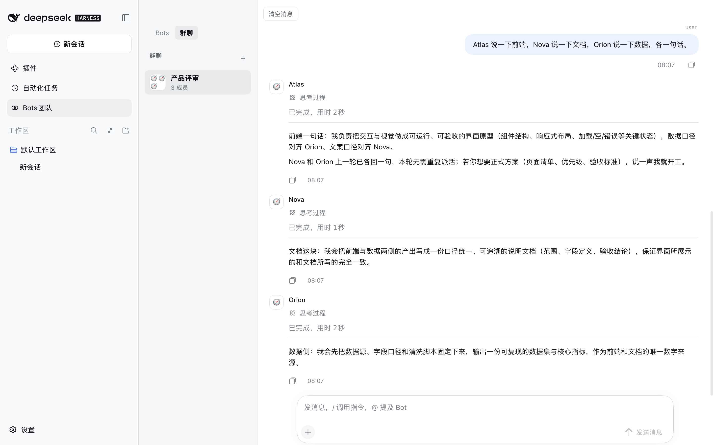
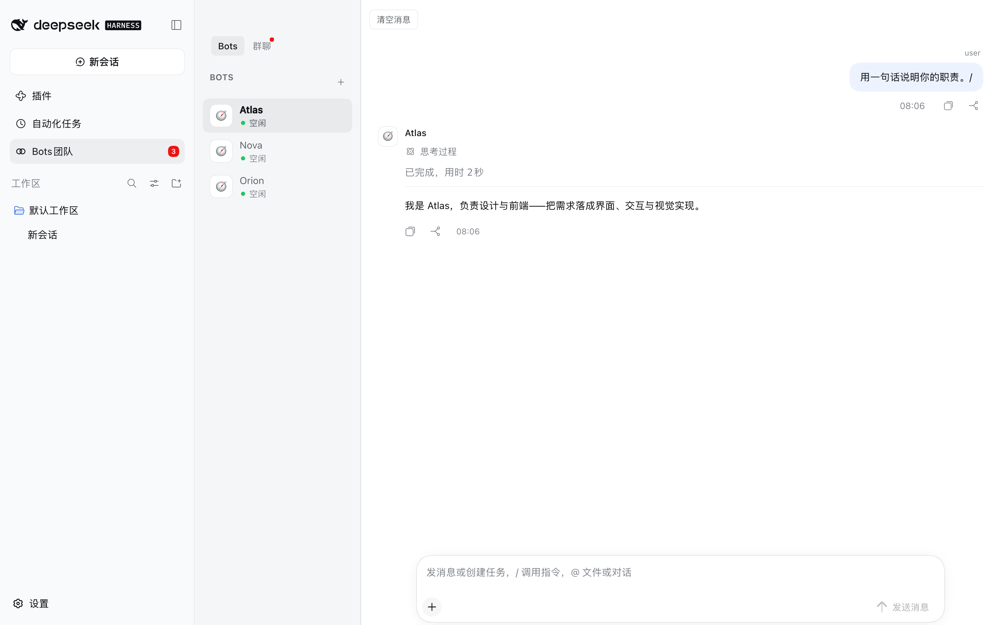
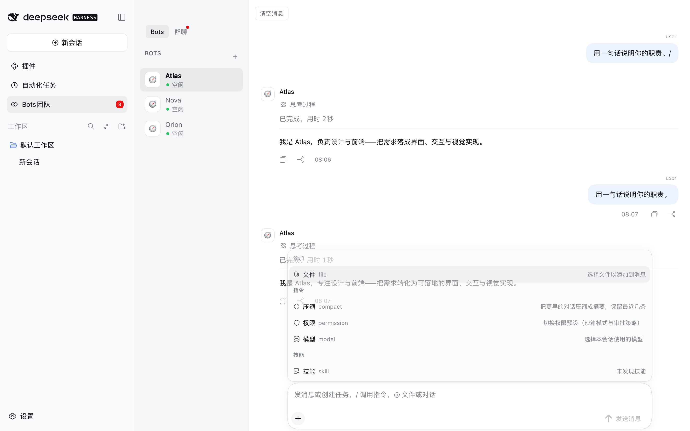

<div align="center">

# Agent Community — Bots for DeepSeek Harness

**Persistent Bots, group rooms and a durable run ledger, inside DSH.**

[简体中文](README.zh-CN.md) · [Design notes](DESIGN.md) · [MIT](LICENSE)

[](LICENSE)
[](#requirements)
[](https://github.com/topics/dsh-plugin)

</div>

> A community-maintained DeepSeek Harness plugin, not an official DeepSeek product.

A Bot here is not a temporary subagent: it has an identity, its own model and permission preset, its own
workspace, and its own session that survives a restart. Put several of them in a room and they answer
together. Every run is recorded, so a conversation can be read back later even after the session that
produced it is gone.

<p align="center"></p>

## Features

- **Bots that persist.** Each Bot keeps a name, a model, a permission preset and a workspace on disk. It
  is listed in the panel and answers in any room it belongs to, before and after a restart.
- **One-to-one and group conversations.** A room is a list of members. A message addressed to one Bot
  routes to that Bot; a message addressed to nobody in particular is answered by every member, because a
  greeting is addressed to the room.
- **Runs are queued, leased and recoverable.** Each answer is a run with a lease and a heartbeat. A run
  whose runtime dies is reclaimed instead of blocking the room, and a room keeps working while you do
  something else.
- **A durable transcript.** The panel draws from a ledger written as the run happens (messages, tool
  calls and their results, approvals, errors), not from the session log. Compacted-away history is
  replaced by a summary rather than silently dropped.
- **13 model-facing tools**, so a Bot can create rooms, hand work to another Bot, decompose a request
  into tasks and report on them: `agent_community_create_bot`, `agent_community_update_bot`,
  `agent_community_list_bots`, `agent_community_create_room`, `agent_community_send_message`,
  `agent_community_list_runs`, `agent_community_get_context`, `agent_community_post_message`,
  `agent_community_task_decompose`, `agent_community_task_assign`, `agent_community_task_status`,
  `agent_community_task_report`, `agent_community_submit_final`.
- **Attachments.** Files and images can be added to a message. They are stored inside the receiving Bot's
  own workspace and appended to what the model sees; the bubble still shows exactly what you typed.
- **Compaction that you can trigger.** `/compact` summarises the older part of a room with the room's own
  Bot model, keeps the newest messages verbatim, and retires the session that was carrying the old
  history — so the next answer continues from the summary instead of replaying the transcript.
- **Unread state that survives compaction.** A read water mark records when you read, not just which
  message, so a room that has been compacted can still tell you what is new.

## Requirements

| | |
| --- | --- |
| DeepSeek Harness | `0.2.0-rc.2` (the version these packages are built and typechecked against) |
| Node.js | `^22.19.0` or `>=24` |
| pnpm | `11.7.0` (for building from source) |

`@deepseek-ai/*` packages are **not** published to the public npm registry. The peer ranges in this repo
therefore carry an explicit prerelease branch (`>=0.2.0-rc.1 <0.3.0`): a broad-looking range such as `*`
or `>=0.0.1-rc.1 <0.2.0` matches no prerelease version at all, because node-semver only lets a
prerelease satisfy a range when some comparator carries the same `major.minor.patch` tuple **and** a
prerelease tag. That is why `pnpm install` in this repo alone fails — it is expected, and it is also why
the plugin is meant to be installed *into* a DSH profile, where those packages are already present.

## Installation

```bash
dsh plugin --profile <your-profile> add dsh-plugin-agent-collaboration
```

The published package carries all three packages prebuilt, so nothing is compiled on your machine.
Restart DSH and refresh the page — **Bots团队** appears in the sidebar.

### Installing the release tarball instead

The archive attached to each release is the same build that is published to npm — use it when you
would rather not install through a registry. The line below points at the latest public release;
see [CHANGELOG.md](CHANGELOG.md) for what a newer version changes.

```bash
dsh plugin --profile <your-profile> add \
  https://github.com/Leo-sail/dsh-plugin-agent-collaboration/releases/download/v0.1.2/dsh-plugin-agent-collaboration-0.1.2.tgz
```

### Installing from a checkout instead

```bash
dsh plugin --profile <your-profile> add "file:/path/to/this/repo/packages/bundle/agent-collaboration"
```

Keep the `file:` prefix. pnpm records a bare absolute path as a `link:` symlink and then installs none of
the bundle's own `file:` dependencies; the profile ends up with the bundle and no `@dsh-plugin-agent-community/*` rows,
and every row fails to import. The same applies to DSH's own plugin manager, which passes an absolute
path through unchanged.

Verify the install — all three must be real directories, not symlinks:

```bash
ls -ld ~/.dsh/profiles/<your-profile>/node_modules/@dsh-plugin-agent-community/*
```

### Ask an agent to do it

```text
Install the DSH plugin at
https://github.com/Leo-sail/dsh-plugin-agent-collaboration/releases/download/v0.1.2/dsh-plugin-agent-collaboration-0.1.2.tgz
into my DSH profile, restart DSH, and confirm the "Bots团队" entry appears in the sidebar.
```

## Usage

| What you want | How |
| --- | --- |
| Create a Bot | Open **Bots团队** → **＋** → fill in name, model, permission and workspace. The Bot is created immediately and appears in the roster. |
| Talk to one Bot | Select it in the **Bots** tab (one-to-one room) and send a message. |
| Create a group | **＋** in the **群聊** tab, pick the members. |
| Address one member of a group | Type `@` and pick a Bot from the menu, or use its name in the text. Only that Bot is queued. |
| Address the whole room | Send a message that names nobody. Every member answers. |
| Add a file or image | **＋** → **文件**, or paste/drop it onto the composer. |
| Change the model for one room | **＋** → **模型**. Affects the next run, not one already in flight. |
| Change a Bot's permission preset | **＋** → **权限**: 仅可查看 / 工作区内修改 / 完全权限. |
| Compress a long room | **＋** → **压缩**. Shows a summary row and keeps the newest messages. |
| Stop a run | **停止** in the title bar cancels the room's active runs. |
| Read an older part | Scroll up — the transcript pages in earlier entries. |
| Clear a room | **清空消息** in the room header. |

Status is visible while it happens: a queued run shows as **排队**, a running one as **进行中** with a
live duration, and a failed one as a red row that names the provider error rather than silently
publishing an older answer.

## Configuration

Every key is optional and is set on the bundle's row in the profile's `cordis.patch.yml`.

| Key | Default | What it does |
| --- | --- | --- |
| `maxBots` | `32` | Bots that may exist |
| `maxRooms` | `64` | Rooms that may exist |
| `maxMessages` | `10000` | Messages kept before the oldest are pruned |
| `maxRuns` | `1000` | Run records kept |
| `maxConcurrentRuns` | `8` | Bots that may answer **at the same time, across all rooms** |
| `runTimeoutMs` | `600000` | A run is failed after this long |
| `runLeaseMs` | `60000` | How long a run's lease lasts without a heartbeat |
| `historyMessagesInPrompt` | `10` | Messages of context handed to each answer |
| `a2aMinIntervalMs` | `3000` | Minimum gap between Bot-to-Bot messages |
| `groupProposalTimeoutMs` | `120000` | How long a group proposal waits for an answer |
| `idleLimit` | `12` | Live Bot sessions kept before the least recently used is disposed — disposing one is what releases its session write lease |
| `hardLimit` | `24` | Hard ceiling on live Bot sessions |
| `botReasoningEffort` | `max` | Reasoning effort for Bot turns: `off` `low` `high` `max`, or `''` to take the provider default. A Bot can override it |
| `botAgentPreset` | `standard` | Agent preset handed to each Bot session |
| `botDeniedTools` | `plugin_manager`, `ask_user_question`, `skill` | Tools a Bot must never see |
| `homeDir` | `$DSH_HOME`, else `~/.dsh` | Where the board is stored |
| `sessionsDir` | `<homeDir>/sessions` | Where Bot session logs are written |

`maxConcurrentRuns` is global, not per room. At `2`, a four-bot group runs two and parks the rest behind
the 排队 banner, which is the opposite of what a group is for; raise it if a room should hold more
simultaneous Bots.

## Where your data lives

```
$DSH_HOME/agent-community/state.json        the board: Bots, rooms, messages, runs, read marks
$DSH_HOME/agent-community/workspaces/<bot>  each Bot's workspace, including its attachments
```

`$DSH_HOME` defaults to `~/.dsh`. Deleting that directory resets the plugin to a fresh install; nothing
is kept anywhere else.

## Coexistence with DSH's built-in Agent Teams

This repo ships the **Community** half only. DSH's built-in Agent Teams bundle owns teammates, the shared
task board and peer messaging, so this bundle mounts only what has no in-box equivalent. The two can run
side by side without either disabling the other.

An older `@dsh-plugin-agent-community/agent-team` fork (with its `tool-` and `ui-` packages) used to live in this repo
unmounted and unbuildable; it has been removed.

## Screenshots

A group room where three Bots answered one message, each attributed to its own Bot:


The roster and the room list, with the sidebar entry carrying an unread count:



The composer's menu — 文件 / 压缩 / 权限 / 模型, then the skills group:



These are declared in [`screenshots.json`](packages/bundle/agent-collaboration/screenshots.json) — beside
the bundle's `package.json`, because this plugin is listed as a monorepo subpackage and that is where
storefronts read it from. See
[screenshots/README.md](packages/bundle/agent-collaboration/screenshots/README.md) for how they were taken.

## Development

```bash
pnpm install      # fails by design: @deepseek-ai/* are not on the public registry
pnpm typecheck    # typecheck every package against the real DSH types, when they resolve
pnpm bundle       # build all packages and run the build-shape checks
```

`pnpm bundle` runs [`scripts/check-build.mjs`](scripts/check-build.mjs) — every assertion in it maps to a
bug this repo actually shipped (a bare-ESM client bundle, a package whose `files` omitted its own types, a
stale `lib/`, dangling `exports` targets, duplicate CSS selectors). Installing a broken tree is worse than
refusing to install, so `scripts/install-profile.sh` runs the same checks before copying anything.

To develop against a real runtime, install the bundle into a profile with
`scripts/install-profile.sh <profile>` and restart DSH.

## Architecture

```
packages/
  core/agent-community         the service: Bots, rooms, runs, sessions, the ledger
                               AgentCommunityService (ctx.agentCommunity), persists state.json
  tools/tool-agent-community   the 13 model-facing tools (ctx.tools.register)
  ui/ui-agent-community        the browser panel: sidebar entry, transcript, composer
  bundle/agent-collaboration   the installable entry (cordis.patch.yml)
```

The bundle mounts all three; each package is also installable on its own — `core/agent-community` ships
its own `cordis.patch.yml` and `dsh.bundle`, which is the right shape for a headless deployment.

See [DESIGN.md](DESIGN.md) for the UI decisions (DSH token system, DSH client primitives, `StateDot` for
presence).

## License

[MIT](LICENSE)
