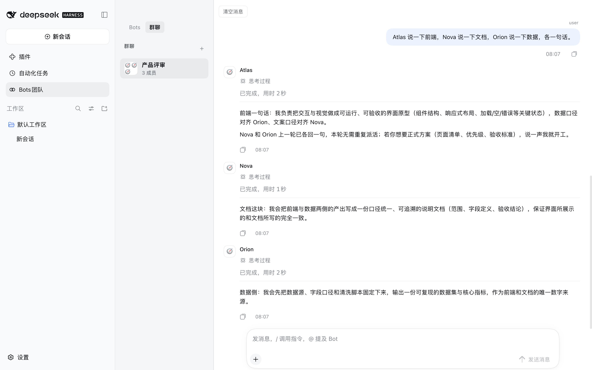
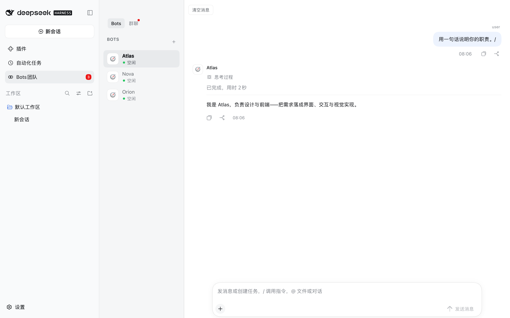
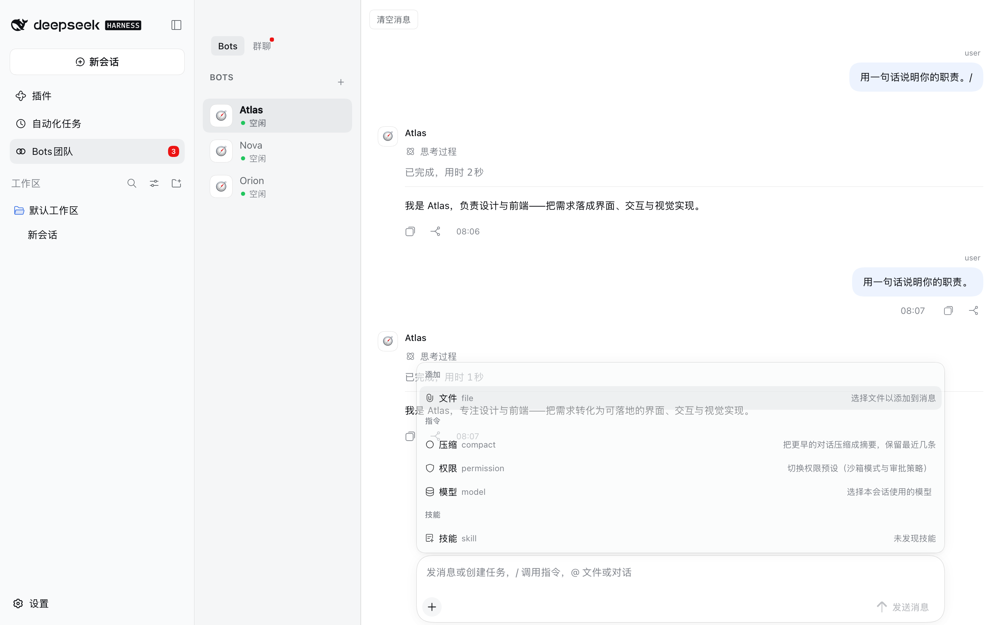
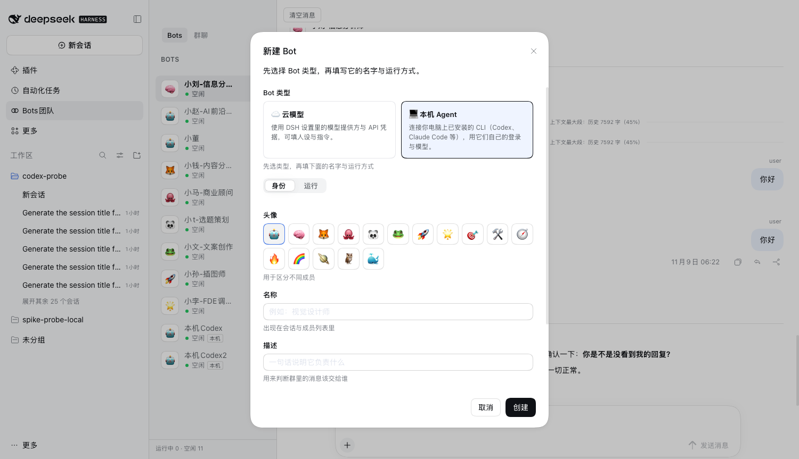
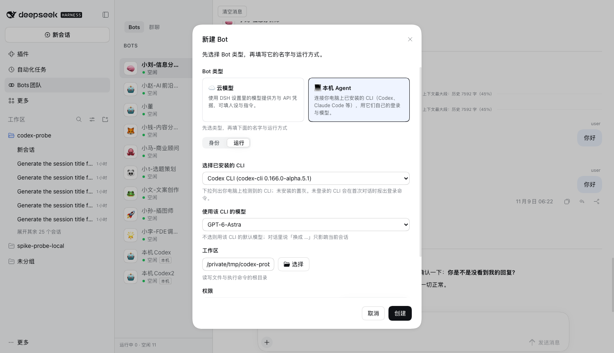

<div align="center">

# Agent Community —— DeepSeek Harness 的持久化 Bot

**在 DSH 里常驻的 Bot、群聊房间，以及一份不会丢的运行记录。**

[English](README.md) · [设计说明](DESIGN.md) · [MIT](LICENSE)

[](LICENSE)
[](#环境要求)
[](https://github.com/topics/dsh-plugin)

</div>

> 本插件由社区维护，不是 DeepSeek 官方产品。

这里的 Bot 不是一次性的子代理：它有身份、有自己的模型与权限预设、有自己的工作区，以及一个**重启后仍在**的会话。
这个会话是 DSH 的原生 Session，但**不会出现在 DSH 侧栏**——面板里只有房间。
把几个 Bot 放进同一个房间，它们会一起回应。每一次回答都有运行记录，所以即使产出它的会话已经不在，对话仍可回看。

<p align="center"></p>

## 功能

- **Bot 是常驻的。** 名字、模型、权限预设、工作区都落在磁盘上，面板里一直列着，重启前后都能在所属房间里回答。
- **单聊与群聊。** 房间就是成员列表。点名某个 Bot 的消息只路由给它。不点名的群消息按房间设置处理：默认沿用现有路由（问候会兜底给 leader），也可以切成「由群主判断」，让 leader 决定自己回答、派给成员或简单收尾。
- **运行可排队、可租约、可恢复。** 每次回答是一个带租约与心跳的 run。运行时进程死掉的 run 会被回收而不是把房间卡住，房间在你去做别的事时照常工作。**用户自己的消息优先**：活跃会话上限占满时，你发起的 run 可以用 1 个保留槽位先开始，定时任务与 Bot 之间的消息继续排队。
- **未点名消息可以观察，也可以交给群主。** 群聊可设 `legacy`（沿用现有路由）、`observe`（只记录会唤醒谁，不建 run）或 `auto`（**由群主判断**：一个 leader 回合决定自己回答 / 派给成员 / 简单收尾）。@点名、书面名字、`@all`、私聊与管理指令始终绕过推断。部署级默认值可用 `admissionDefault`。
- **提前准备（投机执行）是可选功能（产品默认关）。** 群聊可切到「只记录」（记下本可提前准备的时机，不建运行、不花 token）或「开启」（对未点名的任务型消息，在每日硬预算内启动一次隐藏 leader 预演，默认/上限 100 次）。预演 run 持久化标记、绝不重试、不发布回复/报告/文件卡、不写记忆、不参与轮次，只记「命中/未达标」元数据；预演回合内的变更类工具在服务层硬拒绝。房间使用「由群主判断」时不再重复预演。已知限制：预演仍与 leader 共用原生会话。
- **不打开房间也能看到哪里在等你。** 房间列表会给「有待人工处理的事」的房间标上「需要你 N」：房间被暂停、目标停滞、任务完成但证据门被绕过、或 Bot 在等审批。这是一个只读元数据索引（`listOpenWork`），不跨房间带消息正文，Bot 也看不到它。
- **本群经验自动、增量、到 80% 自动提炼。** 每次通过 finish gate 的群任务会往「本群经验」追加或替换一条；文本达到 3000 字上限的 80% 时，由一个隐藏 leader 回合提炼到 30%–55% 上限（低于 20% 的塌缩会被拒绝并保留原文）。设置里也可点「立即整理」。手动编辑过的经验卡不会被自动覆盖。
- **群规则。** 群聊设置里的「群规则」是用户写的 Markdown，房间里每个 Bot 都把它当长期规则读（原「群知识」改名；prompt 段头为 `[本群规则]`）。编辑方式与字符上限不变，空文档不进入 prompt。
- **旧对话仍可回查（默认关）。** 打开 `recallEnabled` 后，超出窗口的历史消息会留下带 id 的 50 字 stub，Bot 可以用只读的 `agent_community_read_history` / `read_run` / `read_task` 按需展开，而不是重读房间或让用户重复。
- **协调者角色（按 Bot 可选）。** 新建 Bot 时可选「成员 / 协调者」：协调者跑在收窄的 `preset-coordinator` 工具世界里，只能路由、分派、收集、收口，`bash`/文件写/联网工具根本不在它的 catalog 里，提示词也要求它如实说「我不执行，转给谁」。改角色需重建会话（清空本房消息或重启）后生效——会话创建时会把 preset 记在 header。
- **每个 run 能说清是哪个事件触发的（默认关）。** 打开 `intakeEnabled` 后，房间的四条驱动来源（用户消息、Bot/A2A 消息、定时任务、目标续跑）会生成统一事件并附上 Fast Path 判定；事件 id 打在它创建的 run 上，最近事件可通过 `listRecentEvents` RPC 查询。
- **新派工任务从交接开始（默认关）。** 打开 `taskSegmentsEnabled` 后，换到另一个派工任务的第一轮会拿到 `[任务段]`：本段任务是什么，以及上一段 finish report 里的事实交接（摘要、交付文件、明确未完成项）——不调用模型总结，不会编造工作。
- **宿主副作用不会因为一次抖动就丢。** 提醒触发后对 host row 的删除/重排在执行前先落盘到 `outbox.json`，失败指数退避重试，连续失败进健康提示——而不是一次瞬时错误就让提醒在「自动化任务」里永远显示 active。
- **一条线程会记住它的负责人（默认关）。** 打开 `threadSubscriptionsEnabled` 后，thread/task 里第一条消息的应答者成为这条线程的负责人，后续「第二个也改一下」这类补充直接交给他们，不再按角色词重猜——除非用户显式 `@`、写出名字或 `@all`。
- **中途改主意会跟进正在跑的那一轮（默认关）。** 打开 `steerEnabled` 后，对同一 thread/task、仍在干活的 Bot 发的补充会注入当前回合，而不是排在它后面新开一轮——你正在等的那份回答就会按补充调整。
- **坏掉的子系统会说出来。** 过去只进日志的失败现在按子系统聚合（路由 / prompt 组装 / 定时投递）：连续 3 次在受影响房间写一条灰行，同一子系统 10 分钟最多一条，成功即清零；`getHealth`（RPC）返回快照用于排障。
- **Bot 不会把一整轮睡过去。** 长任务会被告知转后台 job；插件同时记录（并可用 `noWaitGuard.mode: 'enforce'` 拒绝）三种会冻结回合的调用：`sleep`、超长前台命令、超长 `job_output` 等待。
- **长任务期间能看到进度。** `agent_community_progress` 发一条灰色进度提示（「正在跑测试，约 3 分钟」），不结束回合、也不算最终答复；每个 Bot 每几分钟最多一条。
- **连发消息可以并成一轮（默认关）。** 打开 `batching.enabled` 后，同一个 Bot、同一 thread/task 的 run 还在排队时，用户再发的消息会并入这一轮而不是新开一轮——一次回答对应一串消息，也只付一份 prompt。
- **队长可以问忙碌的成员「到哪了」。** `agent_community_request_status` 把一句进度询问注入成员**正在跑的这一轮**（不新建 run、不占额外槽位）——长任务和卡住的任务不再看起来一样。连续沉默超过无进展窗口大部分时长的 run，也会在预算判失败前被自动询问一次。
- **转录是持久的。** 面板画的是运行过程中写下的 ledger（消息、工具调用与结果、审批、错误），不是会话日志。被压缩掉的旧历史会换成一条摘要，而不是悄悄消失。
- **一组模型可调用工具**，Bot 因此可以建房间、把活交给另一个 Bot、把需求拆成任务并回报（节选）：
  `agent_community_create_bot`、`agent_community_update_bot`、`agent_community_list_bots`、
  `agent_community_create_room`、`agent_community_send_message`、`agent_community_list_runs`、
  `agent_community_get_context`、`agent_community_post_message`、`agent_community_task_decompose`、
  `agent_community_task_assign`、`agent_community_task_status`、`agent_community_task_report`、
  `agent_community_submit_final`、`agent_community_remember`、`agent_community_deliver`。
- **模型全部来自 DSH 设置。** Bot 设置与输入框的模型菜单都读取部署实时的模型目录——全部提供方、全部模型、
  它们在设置里的显示名与思考档位。没有任何厂商/模型名被写死；在设置里新增或改名的提供方无需重启即可出现。
- **Bot 交付的文件有卡片。** Bot 用 `agent_community_deliver` 声明它产出的文件；该回合回复下方会出现文件卡片——
  在面板里预览、用本机关联应用打开、在 Finder 中定位。文件可以在 Bot 工作区里，也可以是任意绝对路径。
- **面板内是真查看器，不是浏览器默认打开。** 点卡片打开右侧预览栏：**PDF** 用内置 PDF.js 自绘（翻页、缩放、
  适应宽度），**`.docx`** 用 docx-preview 直接渲染（分页、正文可选中、适应宽度），**`.xlsx`/`.csv`** 用
  SheetJS（多工作表标签、冻结表头、虚拟滚动）。PowerPoint 与旧版 `.doc`/`.xls` 先由宿主转成 PDF，再进同一个
  PDF 查看器。三个查看器都打包进插件的单文件浏览器产物（3.3 MB，gzip 后约 0.9 MB），面板不会联网取查看器。
  许可证见 [THIRD_PARTY_NOTICES.md](THIRD_PARTY_NOTICES.md)。
- **附件。** 消息可以带文件与图片，存放在接收方 Bot 自己的工作区里，并附到模型看到的内容上；气泡里显示的仍然是你原样输入的东西。
- **可手动触发的压缩。** `/compact` 用该房间自己的 Bot 模型把较早的对话总结成摘要，原样保留最近几条，并**退掉承载旧历史的会话**——所以下一次回答是从摘要继续，而不是把整份记录重放一遍。
- **本机 Agent：Bot 就是你电脑上的 CLI。** Bot 也可以不接云模型，而是直接接管本机已安装的 Codex CLI、
  Claude Code、Gemini CLI、Grok Build、OpenCode、Cline、Cursor CLI、Goose、Qwen Code，或任意兼容 ACP 的
  CLI。它用 CLI 自己的登录、认证与模型配置——DSH 里不存 API Key，也不注入人设提示词。详见
  [本机 Agent](#本机-agent--bot-就是你电脑上的-cli)。
- **未读角标跟着你实际看到的内容走。** 已读水位记的是"读到什么时间"，而不是只记一个消息 id，因此被压缩过的房间仍然能告诉你哪些是新的。**屏幕上的房间即视为已读**——它一显示出来角标就清零，停留期间到达的回复也会立刻清零；只有 DSH 窗口在后台/最小化时到达的消息保持未读，所以你回来时看到的数字仍然是准的。角标按**未读回复条数**计数：每次 Bot 运行算 1 条（定时任务的多次运行分别计数），同一回合里同一 Bot 的附加消息不重复计数。

## 本机 Agent — Bot 就是你电脑上的 CLI

一个 Bot 可以由**本机已安装的 agent** 驱动，而不是云模型。房间、运行、账本、团队工具、审批全部不变，
只是把模型调用换成 CLI 自己的回合。

- **用电脑上已装的 CLI 建 Bot。** 新建 Bot 第一步是两张类型卡片——**云模型 / 本机 Agent**。本机模式会
  列出本机检测到的所有 CLI（Codex CLI、Claude Code、Gemini CLI、Grok Build、OpenCode、Cline、Cursor CLI、
  Goose、Qwen Code，以及自定义 ACP CLI）和该 CLI 配置的模型；未安装的条目显示「未安装」并置灰。
- **用 CLI 自己的登录，而不是 DSH 里的 Key。** 本机 Bot 沿用该 CLI 已有的登录与模型配置；DSH 不为它存
  API Key，也不注入人设/系统提示词。CLI 自己的认证环境变量（`ANTHROPIC_*` 等）和第三方中转照常生效。
- **团队工具照常可用。** 协作工具通过每会话一个 loopback MCP server 暴露给 CLI：CLI 调
  `message_member`、`assign_task`、`ask_user_question`，DSH 像普通工具调用一样执行与审计。
- **审批留在 DSH。** CLI 的命令/文件/MCP 工具权限请求会变成 DSH 审批卡；Bot 的权限 preset 映射到 CLI
  自己的 sandbox/mode（Codex sandbox、Claude `--permission-mode`），拒绝一律 fail-closed。
- **切换模型是真的切换。** 在设置里选模型，或在对话里让 Bot「换成 …」——模型/provider 变化会自动开启
  新的 CLI 会话，并把房间可见历史重新灌入，旧 thread 不会继续用上一个模型回答。
- **自定义 CLI。** 在 Bot 表单底部「管理自定义 CLI」里添加任意 ACP CLI，它会出现在同一个下拉里。

引擎列表是固定的（Codex、Claude Code、ACP 家族）；驱动数据化，缺失的 CLI 只会显示为不可选项，不会让插件失败。

## 环境要求

| | |
| --- | --- |
| DeepSeek Harness | `0.2.2-rc.1`（构建与实测所用版本；插件不锁定 DSH 版本） |
| Node.js | `^22.19.0` 或 `>=24` |
| pnpm | `11.7.0`（从源码构建时需要） |

`@deepseek-ai/*` 这些包**没有**发布到公共 npm registry，因此本仓库单独 `pnpm install` 解析不到它们（属于预期）。
插件**刻意不锁定 DSH 版本**：所有 peer 范围都是 `*`，缺少宿主包时降级加载而不是让安装失败。这也是这个插件要装进
**由目标运行时提供这些包的 DSH profile** 的原因。

## 安装

```bash
dsh plugin --profile <你的profile> add dsh-plugin-agent-collaboration
```

包里已经带了四个**预构建**的组件，本机不会编译任何东西。装完重启 DSH 并刷新页面，侧栏会出现 **Bots团队**。

### 改用 release tarball 安装

```bash
dsh plugin --profile <你的profile> add \
  https://github.com/Leo-sail/dsh-plugin-agent-collaboration/releases/download/v0.5.0/dsh-plugin-agent-collaboration-0.5.0.tgz
```

同一份产物，附在 release 上——不想经过 registry 就直接用它。

### 改用本地源码目录安装

```bash
dsh plugin --profile <你的profile> add "file:/path/to/this/repo/packages/bundle/agent-collaboration"
```

**`file:` 前缀不要去掉。** pnpm 会把裸绝对路径记成 `link:` 符号链接，于是 bundle 自己的 `file:` 依赖一个都不会被安装：
profile 里只有 bundle、没有 `@dsh-plugin-agent-community/*` 那几行，结果每一行都 import 失败。DSH 自带的插件管理器同样如此，它会把绝对路径原样透传。

确认安装结果——四行都必须是**真实目录**而不是符号链接：

```bash
ls -ld ~/.dsh/profiles/<你的profile>/node_modules/@dsh-plugin-agent-community/*
```

### 让 Agent 帮你装

```text
> **注意**：仓库当前版本是 **0.5.0**，与下面的链接一致；改动见 [CHANGELOG.md](CHANGELOG.md)。

把 https://github.com/Leo-sail/dsh-plugin-agent-collaboration/releases/download/v0.5.0/dsh-plugin-agent-collaboration-0.5.0.tgz
装进目标 DSH profile，重启 DSH，并确认侧栏出现「Bots团队」。
```

## 使用

| 想做什么 | 怎么做 |
| --- | --- |
| 新建 Bot | 打开 **Bots团队** → **＋** → 填名字、模型、权限、工作区。立刻创建并出现在列表里。 |
| 和单个 Bot 对话 | 在 **Bots** 标签里选中它（单聊房间），然后发消息。 |
| 建群聊 | **群聊** 标签里的 **＋**，勾选成员。 |
| 只叫群里某一个人 | 输入 `@` 从菜单里选；或直接在文字里写它的名字。只有它会被排队。 |
| 说给整个房间 | 用 `@all`（所有成员都会运行）。不点名的消息按房间设置处理：现有路由 / 只记录 / 群主判断。 |
| 加文件或图片 | **＋** → **文件**，或直接粘贴/拖到输入框。 |
| 给某个房间换模型 | **＋** → **模型**。影响下一次运行，不影响正在跑的那一次。 |
| 改 Bot 的权限预设 | **＋** → **权限**：仅可查看 / 工作区内修改 / 完全权限。 |
| 压缩很长的房间 | **＋** → **压缩**。会出现一条摘要行，并保留最近几条。 |
| 停止运行 | 标题栏的 **停止** 会取消该房间正在跑的 run。 |
| 看更早的内容 | 往上滚，转录区会分页加载更早的记录。 |
| 清空房间 | 房间标题栏的 **清空消息**。 |

过程是可见的：排队的 run 显示 **排队**，运行中的显示 **进行中** 并带实时耗时，失败的显示为**红色行并写明 provider 的错误**，
而不是悄悄把更早的一条回答当成新回答发出来。

## 配置

所有配置项都是可选的，写在 profile 的 `cordis.patch.yml` 里 bundle 那一行的 `config` 下。

| 键 | 默认值 | 作用 |
| --- | --- | --- |
| `maxBots` | `32` | 允许存在的 Bot 数 |
| `maxRooms` | `64` | 允许存在的房间数 |
| `maxMessages` | `10000` | 保留的消息数，超出后淘汰最旧的 |
| `maxRuns` | `1000` | 保留的运行记录数 |
| `maxConcurrentRuns` | `8` | **全局**同时在回答的 Bot 数（不是每房间） |
| `runTimeoutMs` | `900000` | 超过此时长的 run 判定为失败（自适应：bootstrap 900s / floor 180s / cap 7200s） |
| `runLeaseMs` | `60000` | 没有心跳时，run 租约的有效时长 |
| `historyMessagesInPrompt` | `10` | 每次回答附带的历史消息条数 |
| `admissionDefault` | `"legacy"` | 没有单独设置准入的群聊使用：`legacy` 保持旧路由；`observe` 只记录；`auto` 把未点名消息交给群主判断（自己回答 / 派给成员 / 简单收尾）。2026-11-09 新增 |
| `groupProposalTimeoutMs` | `120000` | 建群提议等待回答的时长 |
| `approvalTimeoutMs` | `120000` | Bot 审批对话框无人应答后自动拒绝的时长（执行器 watchdog 晚 15s 兜底未被审批桥接单的请求）；`0` 表示两套 watchdog 都关闭、永不超时 |
| `idleLimit` | `12` | 最多保留多少个活跃 Bot 会话，超出后淘汰最久未用的——淘汰正是释放其会话写租约的时机 |
| `hardLimit` | `24` | 活跃 Bot 会话的硬上限；用户发起的 run 可多用 1 个（见 `humanPriority`） |
| `humanPriority` | `true` | 为用户发起的 run 保留 1 个额外活跃会话槽位：即使自动化任务占满普通槽位，你的消息也能先开始。设 `false` 则所有 run 回到旧上限 |
| `batching` | `{ enabled: false, windowMs: 2500, maxMessages: 5 }` | 把连发的用户消息合并进同一目标、同一 thread/task、**尚未开始**的排队 run（滑动窗口内）；默认关，运行中的 run 永不合并 |
| `steerEnabled` | `false` | 把同一目标 + 同一 thread/task 的中途补充注入**正在跑**的 run（不新建 run、不占槽位）；一条消息的所有目标都满足才生效，回合已结束则回退为新 run。默认关 |
| `threadSubscriptionsEnabled` | `false` | 让已知 thread/task 里的消息直接交给负责它的 Bot，而不是每次按文本重猜；显式 `@`、书面名字、`@all` 仍然优先。默认关 |
| `threadSubscriptionTtlMs` | `86400000` | thread/task 订阅的空闲有效期，每次路由命中会刷新（每房间最多 50 条、每线程最多 5 个 Bot） |
| `outboxEnabled` | `true` | 对可失败的**宿主**副作用做持久重试（目前是：提醒触发后在 DSH 定时服务里删除/重排 host row）。存 `outbox.json`、指数退避、最多 3 次，之后进一条健康提示；关掉则回到旧的 fire-and-forget |
| `taskSegmentsEnabled` | `false` | 新的**派工任务**第一轮注入 `[任务段]` 边界，并附带由上一段 finish report 确定性生成的交接（摘要/交付物/明确未完成项），已放在 prompt 的证据 guard 内。默认关 |
| `recallEnabled` | `false` | 链式召回：旧的聊天记录变成 50 字 stub（带消息 id）而不是直接消失，prompt 增加 `[更早内容与引用]` 段，Bot 获得 `agent_community_read_history/read_run/read_task` 三个只读工具（只能读本房间） |
| `recallStubChars` | `50` | 每条 stub 保留的字符数（超出用 `…`） |
| `recallMaxStubs` | `40` | 一个窗口块里最多保留多少条 stub（保留离窗口最近的旧消息） |
| `speculationDefault` | `{ mode: "off", dailyLimit: 100 }` | 没有单独设置 `speculation` 的群聊使用的部署级默认（产品默认 off；在这里打开会对所有群生效，仍受 `dailyLimit` 限制，默认/上限 100） |
| `intakeEnabled` | `false` | 给每个新建 run 打上触发它的 intake 事件 id，并在内存里保留有界轨迹（`listRecentEvents` RPC）。纯观测，不改变四条驱动路径的行为 |
| `noWaitGuard` | `{ mode: 'observe', maxForegroundMs: 30000, maxJobWaitMs: 5000 }` | 阻止 Bot 用 `sleep`、长前台命令或长时间 `job_output` 等把整轮卡住。`observe`（默认）只记日志；`enforce` 拒绝调用并提示改用后台 job；`off` 关闭。用户自己的会话不受影响 |
| `healthFailureThreshold` | `3` | 子系统（路由 / prompt 组装 / 定时投递）连续失败多少次后，在受影响房间写一条错误提示 |
| `healthNoticeCooldownMs` | `600000` | 同一子系统两条健康提示之间的最小间隔 |
| `botReasoningEffort` | `''` | Bot 回合的默认推理强度：`''` 交给 provider 默认值，也是唯一在所有路由上都安全的值。只有模型公布了该档位时才设 `off` / `low` / `high` / `max`——模型没公布档位时会拒绝任何显式值，每个回合都会失败。单个 Bot 可覆盖 |
| `botAgentPreset` | `bot` | 传给每个 Bot 会话的 agent preset（需在 profile 里挂载；本 bundle 自带 `preset-bot`） |
| `coordinatorAgentPreset` | `coordinator` | 角色为「协调者」的 Bot 挂载的 preset（本 bundle 自带 `preset-coordinator`：没有 bash / 文件写 / 联网 / 子代理）。未设角色的 Bot 仍用 `botAgentPreset` |
| `botDeniedTools` | `plugin_manager`、`ask_user_question`、`skill` | Bot 永远看不到的工具 |
| `homeDir` | `$DSH_HOME`，否则 `~/.dsh` | 看板存放位置 |
| `adoptLegacyBoard` | `true` | 当 `$DSH_HOME` 里还没有看板、而 `~/.dsh` 里有时，继续使用 `~/.dsh`（升级兼容行为）。测试/验收实例设 `false`，让空的 `$DSH_HOME` 真的保持为空 |
| `sessionsDir` | `<homeDir>/sessions` | Bot 会话日志的写入位置 |

`maxConcurrentRuns` 是**全局**的，不是每房间的。设成 `2` 时，四个 Bot 的群只有两个能回答，其余两个卡在 **排队** 后面——
这正好和"建群就是为了让成员同时干活"相反。需要更多并发就调大它。

## 数据放在哪

```
$DSH_HOME/agent-community/state.json        看板：Bot、房间、消息、运行、已读水位
$DSH_HOME/agent-community/workspaces/<bot>  每个 Bot 的工作区，附件也在里面
```

`$DSH_HOME` 默认是 `~/.dsh`。删掉这个目录就等于把插件恢复成全新安装；数据不存放在别处。

**隔离实例。** 只设 `$DSH_HOME` **不足以**隔离看板：新 home 里还没有 `agent-community/state.json`、
而 `~/.dsh` 里有时，插件会沿用真实看板（日志里有一条 warn）。测试/验收实例请把 `homeDir` 指到全新目录，
或设 `adoptLegacyBoard: false`——这样新 home 从空开始，真实看板完全不被碰。

## 与 DSH 内置 Agent Teams 的关系

本仓库只发布 **Community** 这一半。DSH 内置的 Agent Teams bundle 负责队友、共享任务板与点对点消息，
所以本 bundle 只挂载**内置版没有对应物**的部分。两者可以并存，不需要关掉任何一个。

仓库里曾经有一个未挂载、也无法构建的 `@dsh-plugin-agent-community/agent-team` 分支（连同它的 `tool-`、`ui-` 包），已删除。

## 截图

群里一条消息，三个 Bot 各自回答、各自署名：


Bot 列表与房间列表，侧栏入口带未读数：



输入框的菜单——文件 / 压缩 / 权限 / 模型，下面是技能分组：



新建 Bot 的第一步是类型卡片——**云模型 / 本机 Agent**；本机模式会列出本机已安装的 CLI：





这些截图声明在 [`screenshots.json`](packages/bundle/agent-collaboration/screenshots.json) 里——它放在
bundle 的 `package.json` 旁边，因为本插件以 monorepo 子包的形式收录，市场正是从这个位置读取它。
拍摄方式见 [screenshots/README.md](packages/bundle/agent-collaboration/screenshots/README.md)。

## 开发

```bash
pnpm install      # 按设计会失败：@deepseek-ai/* 不在公共 registry 上
pnpm typecheck    # 依赖可解析时，对所有包做真实 DSH 类型的类型检查
pnpm bundle       # 构建全部包并跑构建形状检查
```

> **浏览器产物依赖。** 面板内的三个查看器（PDF.js / docx-preview / SheetJS）在构建时被打进
> `ui-agent-community/lib/client.js`：DSH 的客户端模块系统每个插件只取一个脚本，不会去读兄弟资源，
> 所以不能把 worker 或查看器当作独立文件发布。这些库因此是 workspace 的 devDependencies（根
> `package.json`），安装一次即可构建；产物体积 3.3 MB（gzip 后约 0.9 MB），许可证见
> [THIRD_PARTY_NOTICES.md](THIRD_PARTY_NOTICES.md)。

`pnpm bundle` 会运行 [`scripts/check-build.mjs`](scripts/check-build.mjs)——里面每一条断言都对应本仓库**真实出过**的一个 bug
（裸 ESM 的客户端 bundle、`files` 漏掉自己的类型声明、过期的 `lib/`、指向不存在文件的 `exports`、重复的 CSS 选择器）。
装上一个坏掉的产物比拒绝安装更糟，所以 `scripts/install-profile.sh` 在拷贝任何东西之前会跑同一套检查。

要对着真实运行时开发，用 `scripts/install-profile.sh <profile>` 装进一个 profile，然后重启 DSH。

## 架构

```
packages/
  core/agent-community         服务：Bot、房间、运行、会话、ledger
                               AgentCommunityService（ctx.agentCommunity），持久化 state.json
  tools/tool-agent-community   模型可调用工具（ctx.tools.register）
  core/local-agent             本机 Agent 服务：发现、LLM 适配器与 Codex / Claude Code / ACP 驱动（loopback MCP、审批）
  ui/ui-agent-community        浏览器面板：侧栏入口、转录区、输入框、右侧预览栏与三个查看器
  bundle/agent-collaboration   可安装入口（cordis.patch.yml）
```

bundle 会挂载上面四个包；每个包也**可以单独安装**——`core/agent-community` 自带 `cordis.patch.yml` 与 `dsh.bundle`，
这正是无界面部署需要的形态。

界面相关决策见 [DESIGN.md](DESIGN.md)（DSH token 体系、DSH 客户端原语、用 `StateDot` 表示状态）。

## 许可证

[MIT](LICENSE)

浏览器产物内打包的第三方库（PDF.js、docx-preview、JSZip、SheetJS）另按各自许可证分发，见
[THIRD_PARTY_NOTICES.md](THIRD_PARTY_NOTICES.md)。
